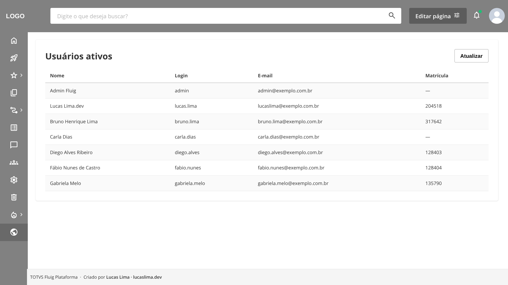

# fluig-widget-local

Estrutura base para desenvolver a **interface** de widgets do Fluig no navegador, com o [Live Server](https://marketplace.visualstudio.com/items?itemName=ritwickdey.LiveServer), sem exportar para o servidor a cada ajuste.

O passo a passo completo está no post **[Desenvolvendo widgets do Fluig localmente com o Live Server](https://lucaslima.dev/blog/widget-local-live-server)**, no lucaslima.dev.



## O que este projeto faz

- Usa o **JavaScript real da widget**, sem alterações. Na hora de exportar, não há nada para trocar.
- Simula no navegador o que o Fluig fornece: `SuperWidget` (com `bindings`), `DatasetFactory`, `ConstraintType`, `WCMAPI` e `FLUIGC`.
- Devolve **dados fictícios** no mesmo formato que o `getDataset` retorna.
- Replica os **estilos base** do Fluig, o topo e o menu lateral, para a widget ficar igual no local e no servidor.

> **Só a interface.** O ambiente local serve para construir layout, estilos, componentes e interações. Datasets reais, integrações, usuário logado, permissões e regras de negócio continuam sendo desenvolvidos e testados no Fluig.

## Estrutura

```
fluig-widget-local/
├── datasets/             ← pastas padrão de um projeto do Fluig Studio
├── events/
├── forms/
├── mechanisms/
├── reports/
├── workflow/
├── wcm/widget/listaUsuarios/
│   └── src/main/
│       ├── resources/view.ftl
│       └── webapp/resources/
│           ├── css/listaUsuarios.css
│           └── js/listaUsuarios.js
├── index.html            ← página de testes local
├── preview.mock.js       ← dados fictícios dos datasets
└── preview.local.js      ← simula o que o Fluig fornece
```

As pastas `datasets`, `events`, `forms`, `mechanisms`, `reports` e `workflow` seguem a estrutura de um projeto do Fluig Studio e estão vazias, só com um `.gitkeep` para o Git manter as pastas.

O `index.html`, o `preview.mock.js` e o `preview.local.js` só existem no ambiente local. Eles não entram na exportação da widget.

## Como usar

1. Clone o repositório e abra a pasta no VS Code.
2. Instale a extensão [Live Server](https://marketplace.visualstudio.com/items?itemName=ritwickdey.LiveServer).
3. Abra o `index.html` e clique em **Go Live**, no canto inferior direito.
4. A widget de exemplo abre com a lista de usuários ativos do dataset `colleague`. O navegador recarrega sozinho sempre que você salva um arquivo.

## Usando com a sua widget

1. **Copie a sua widget** para a pasta `wcm/widget/`, como ela está no projeto do Fluig Studio.
2. **No `index.html`, substitua o bloco marcado com `SUA WIDGET`** pelo HTML do `view.ftl` e troque o `${instanceId}` por `local`.
3. **Aponte o último `<script>`** do `index.html` para o JavaScript da sua widget, e o `<link>` do CSS para o CSS dela.
4. **Cadastre os dados fictícios** no `preview.mock.js`, com o mesmo nome do dataset. Para descobrir as colunas, abra o dataset em **Painel de controle > Datasets** ou rode o `getDataset` no console do navegador, dentro do Fluig.
5. **Confira o nome do objeto** da widget. O `preview.local.js` inicializa `MyWidget`, o nome padrão do Fluig Studio. Se a sua usar outro nome, troque na última parte do arquivo.

Quando a interface estiver pronta, leve as mudanças do HTML para o `view.ftl` e exporte a widget pelo Eclipse (Fluig Studio).

## Limites da simulação

- O `DatasetFactory` local não executa datasets. Ele só devolve os dados do `preview.mock.js` e aplica filtros `MUST` por igualdade.
- O `WCMAPI.getUser()` devolve um usuário fixo, e o `FLUIGC.toast` só mostra a mensagem no console.
- O CSS do topo e do menu é uma réplica para referência visual. Ajuste as cores conforme o tema do seu Fluig.

---

Criado por [Lucas Lima](https://lucaslima.dev) · [@luccsll](https://www.linkedin.com/in/luccsll)
